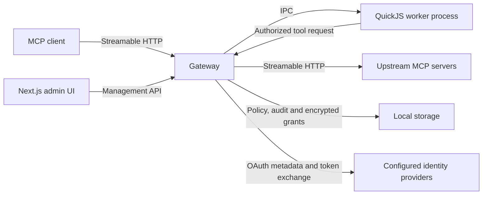

# MCP Code Mode Gateway (experimental)
Vendor-neutral MCP gateway exposing search, describe and execute instead of every upstream tool. TypeScript input is transpiled (syntax checking, not semantic type checking), then evaluated in QuickJS WASM. Tool results remain MCP envelopes.

[日本語の使い方](docs/ja.md)

## Architecture

The Gateway keeps model-facing tool definitions fixed while discovering upstream
schemas as needed. Its `describe` tool supplies JSON Schema and a TypeScript
declaration for selected tools. Execution runs on the deployment host, and the
Broker enforces tool-specific access before sending requests to a configured
upstream. The admin UI, SQLite storage and Docker deployment run on the same
self-hosted stack.



Anthropic describes progressive discovery and code execution for MCP, and
Cloudflare shows the same approach with search and execute. This Gateway
adds a dedicated schema operation, per-user grants and vendor-neutral
self-hosting. [Anthropic engineering article](https://www.anthropic.com/engineering/code-execution-with-mcp) · [Cloudflare Code Mode](https://blog.cloudflare.com/code-mode-mcp/)

## Run
Node 22.13+, npm ci, npm run build. Copy config.example.json to config.json. Configure trusted upstream URLs, token environment variable names and explicit allowed tools. Set GATEWAY_TOKEN to a random string of at least 32 characters and run npm start. Connect to http://127.0.0.1:3000/mcp with Authorization: Bearer <token>. Default Host is 127.0.0.1:3000; set ALLOWED_HOST explicitly for reverse proxies, and ALLOWED_ORIGIN if needed. Bind only to localhost unless using a trusted TLS proxy.

## Docker Compose

Install Docker Engine with the Compose plugin. From the repository root, copy
`config.example.json` to `config.json` and edit it with trusted upstream URLs and
explicit tool allowlists. To start without an upstream, use an empty JSON array.
Export a randomly generated `GATEWAY_TOKEN` of at least 32 characters and run
`docker compose up --build`. If an upstream uses a service token, inject its
named environment variable into the Gateway service using a private Compose override.

Connect MCP clients to `http://127.0.0.1:3000/mcp` and open the admin UI at
`http://127.0.0.1:3001`. Both ports are published on loopback. The admin proxy connects through the private Compose network using the explicitly allowed `gateway:3000` Host. The Gateway persists server settings, policies, audit events and OAuth grants in the `state` volume. Use Docker Engine on Linux for this configuration.

## OAuth resource server
Alternatively set OAUTH_CONFIG to JSON with issuer, jwks, resource (exact HTTPS MCP URL), and users array of {sub,allow:["demo.list_items"]}. Use an external OAuth authorization server that supports MCP resource audiences and PKCE. JWT verification supports RS256 and ES256, validates issuer, audience, expiry and subject, and exposes protected resource metadata. Unknown subjects are denied. Never pass incoming tokens upstream. This config establishes the identity used for per-user upstream delegation.

## Example
Search for list_items, describe demo.list_items, then execute with language typescript:
```ts
const id: string = "demo.list_items";
const result = await mcp.call(id, {});
return result.content;
```
Describe generates conservative declarations from input JSON Schema; unsupported constructs map to unknown. The catalog refreshes every minute. A failed upstream is removed from the exposed catalog until it reconnects. Calls are explicitly authorized per subject. Limits: 20 calls per execution, 15-second target deadline, 32 MiB QuickJS heap, 4 concurrent executions (default) and 32 concurrent HTTP requests. No transactional semantics.

## Docker
Build with docker build -t mcp-code-mode . and run with an env file and read-only config mount. Publish only on localhost (127.0.0.1:3000:3000). Set memory/CPU limits, read-only root filesystem and no-new-privileges. Never mount Docker socket or credentials into the sandbox.

## Tests
npm test; npm run lint; npm run typecheck; npm audit --audit-level=high. npm run benchmark measures serialized JSON tokens using cl100k_base and o200k_base; pass a local JSON array of tool definitions with `npm run benchmark -- path/to/catalog.json`. The comparison covers multiple catalog sizes and itemizes search, describe and execute overhead for an illustrative call. It excludes execution results, generated declarations, prompts and protocol framing.

## References
- https://modelcontextprotocol.io/specification/
- https://ts.sdk.modelcontextprotocol.io/server
- https://github.com/panva/jose
- https://github.com/justjake/quickjs-emscripten
- https://www.anthropic.com/engineering/code-execution-with-mcp

## Catalog UI
Open `/admin` and enter a valid access token to inspect the authorized catalog. Use **Search**, **Previous** and **Next** to browse all authorized tools. The token is not persisted. This is a read-only catalog viewer, not a configuration editor. Synthetic benchmark excludes protocol overhead.

## Next.js administration UI
The separate app in `apps/admin` uses Next.js App Router, TypeScript, MUI Core and Emotion (free OSS components). Start the gateway first, then run `cd apps/admin && npm ci && npm run dev`. Open http://127.0.0.1:3001. Set GATEWAY_URL on the UI server if needed; the gateway Host allowlist must match that URL. The same-origin server route proxies the access token only to the configured gateway and does not store it. Dashboard counts summarize the authorized catalog and the retained execution history. The tool list supports server-side search, pagination and schema inspection. Dark mode and responsive navigation are supported. The /manage page edits additional subject restrictions and displays recent audit events. Administrators can create custom roles, assign roles to external OAuth subjects, disable assigned users and filter the recent audit list. The /servers page manages upstream URLs, credential bindings, connection status and tool allowlists. Build the UI container with `docker build -t mcp-code-mode-admin apps/admin`; configure a private network and GATEWAY_URL, and publish only to localhost or a trusted TLS proxy.

## Administrative policy and isolated execution
Set ADMIN_SUBJECTS to a comma-separated list of trusted OAuth subject IDs (static operator is also admin). /manage provides an additional deny-by-default-for-listed-subjects policy editor and paginated and searchable retained audit events. Clients updating `/admin/state` must include the `revision` from the latest GET in the PUT body. A stale revision gives HTTP 409 and requires a fresh GET before editing. Policies persist atomically in STATE_PATH (default state.json); mount a private writable directory. The Gateway image defaults to /data/state.json, so mount /data as a persistent volume. Tool outcomes and policy changes are persisted in a local SQLite file at AUDIT_PATH (default STATE_PATH plus .audit.sqlite). AUDIT_RETENTION_DAYS defaults to 30. Audit events omit tool arguments, responses and credentials. Protect both files and their parent directory with OS permissions. Upstream redirects are disallowed. Existing OAuth allowlists remain the upper bound. QuickJS now runs in a separate Node child with empty environment and Node permission restrictions, a hard parent deadline and bounded IPC. This is not OS-level network isolation; use a restricted container.

### Roles

Gateway authenticates subjects using the configured OAuth issuer. Administrators can enroll subjects in the UI, which requires an explicit tool allowlist, or manage assignments for subjects in the environment configuration. Only the configured issuer can authenticate either type of subject.
The built-in Viewer role reads the catalog. Operator also executes tools.
Admin also manages policy. Custom roles select read, execute and manage
capabilities, with server and tool allowlists intersected with the existing
subject restrictions. A role with manage capability can edit all Gateway
policies, so grant it only to administrators. Bootstrap administrators from
`ADMIN_SUBJECTS` and the static administrator token retain management access
for recovery. Their upstream tool allowlists still apply. Subjects with
no assignment retain their previous permissions. Removing an assignment
restores those permissions. Disable the assignment to suspend an existing
OAuth subject at the Gateway.

### Execution limits

`EXECUTION_CONCURRENCY` defaults to 4, `EXECUTION_QUEUE_SIZE` to 8, and
`EXECUTION_QUEUE_WAIT_MS` to 5000. `EXECUTION_TIMEOUT_MS` defaults to 15000. Administrators can override these values
from **Settings**. A full queue or expired queue wait
returns an MCP tool error. Closing the HTTP connection or cancelling the
MCP request stops queued execution or terminates the worker process and
aborts pending upstream calls. Upstream side effects may already have
occurred when cancellation is received.

### Managing upstream servers

`CONFIG_PATH` is the operator-managed bootstrap file. It also defines
endpoints trusted to use private addresses or loopback HTTP. The admin
API persists the active configuration in `UPSTREAMS_PATH` (default
`STATE_PATH` plus `.servers.json`). Restart loads the saved configuration
while still reading trust and credential bindings from the bootstrap file.

URLs added in the admin UI require HTTPS and public address resolution.
The Gateway rejects redirects and restricts its HTTP client to the approved
origin. Avoid secrets in URLs. For a new Bearer credential, set
`UPSTREAM_CREDENTIALS` in the Gateway environment to a JSON array of
`{"url":"https://example.com/mcp","tokenEnv":"EXAMPLE_MCP_TOKEN"}`
bindings and inject the named token separately. Each token is bound to the
exact endpoint. Only the environment variable name is returned to administrators.
The admin form supports uncredentialed connections by leaving that field blank.
Use the network firewall to restrict egress for operator-trusted endpoints.

### Connecting users to upstream OAuth

1. Configure Gateway authentication with `OAUTH_CONFIG` and enroll the user
   subjects in that config or in the administration UI. The static bearer token represents a single administrator identity.
2. Register the remote MCP URL in the server registry, leaving the shared token
   environment variable empty. Add an exact URL and issuer binding in
   `UPSTREAM_OAUTH_CONFIG`. For example:
   `[{"id":"inventory","url":"https://mcp.example.com/mcp","issuer":"https://identity.example.com","clientId":"gateway-client-id","scope":"inventory.read"}]`.
   Add `clientSecretEnv` for a confidential pre-registered client. With no
   `clientId`, the Gateway requests a dynamic registration from the configured
   issuer when it advertises an RFC 7591 registration endpoint.
3. Set `UPSTREAM_OAUTH_REDIRECT_URL` to the exact administrator UI callback,
   for example `https://admin.example.com/api/oauth/callback` (loopback HTTP is
   usable with a provider that allows it). Register the same URL at the issuer.
   Set `UPSTREAM_OAUTH_KEY` to a stable, random 32-byte base64url key. For
   example, generate one with `node -p "require('node:crypto').randomBytes(32).toString('base64url')"`.
4. Sign in on **OAuth Connections** with the Gateway token issued for your
   subject, then connect the upstream account in the browser. After the
   issuer redirects back, re-enter your Gateway token to reload status.

Discovery requires protected-resource metadata for the exact MCP endpoint
and an advertised issuer that matches the configured issuer. Authorization
endpoints, including any configured `revocationEndpoint`, must use that
issuer's HTTPS origin and resolve publicly. Authorization uses code flow
with S256 PKCE, a one-time state and a browser binding. Matching OAuth
credentials are encrypted in `UPSTREAM_OAUTH_PATH` (default `STATE_PATH`
plus `.oauth.sqlite`). A missing or changed key prevents access to existing
grants until they are replaced. Back up the key separately from the data.
Tokens and the MCP sessions opened with them are scoped to the user.
Use a single Gateway instance per vault. Refresh locking and pending
authorization state are local to that process. Disconnect always deletes
local credentials and attempts upstream revocation when an endpoint is available.
Already-running upstream calls can continue until they complete or are cancelled.

## MCP client setup

- **Codex CLI or IDE**. Add a Streamable HTTP server in `~/.codex/config.toml`.
  Set the environment variable in the process launching Codex. For OAuth,
  configure the HTTPS Gateway URL and use `codex mcp login code-mode`.
  [Codex MCP guide](https://developers.openai.com/codex/mcp)
- **ChatGPT**. If the workspace supports developer mode, add the reachable
  HTTPS `/mcp` URL as a custom MCP app. Configure the Gateway and external
  issuer for OAuth with the exact resource audience, then select the
  available authentication settings for that app.
  [ChatGPT developer mode](https://help.openai.com/en/articles/12584461-developer-mode-apps-and-full-mcp-connectors-in-chatgpt-beta)
- **Claude**. Add a remote MCP custom connector with the reachable HTTPS
  `/mcp` URL. Use configured OAuth or a fixed `Authorization` header when
  the account supports custom headers.
  [Claude custom connectors](https://support.claude.com/en/articles/11175166-get-started-with-custom-connectors-using-remote-mcp)
- **Other MCP clients**. Set the Gateway endpoint as Streamable HTTP and send
  a Gateway bearer credential. The SDK client integration is exercised with
  local fixtures. Codex, ChatGPT, Claude and external providers have not been
  exercised end to end.

```toml
[mcp_servers.code-mode]
url = "http://127.0.0.1:3000/mcp"
bearer_token_env_var = "GATEWAY_TOKEN"
```

## Environment

| Variable | Purpose |
| --- | --- |
| `GATEWAY_TOKEN`, `OAUTH_CONFIG`, `ADMIN_SUBJECTS` | Choose static single-identity authentication or a trusted external JWT issuer and bootstrap administrators. |
| `PORT`, `BIND_HOST`, `ALLOWED_HOST`, `ADDITIONAL_ALLOWED_HOSTS`, `ALLOWED_ORIGIN` | Listener and exact Host/Origin checks. |
| `CONFIG_PATH`, `UPSTREAMS_PATH`, `UPSTREAM_CREDENTIALS` | Bootstrap, persisted active servers and endpoint-bound Bearer credential variables. |
| `STATE_PATH`, `AUDIT_PATH`, `AUDIT_RETENTION_DAYS` | Policy/settings file and audit storage. Default audit retention is 30 days. |
| `UPSTREAM_OAUTH_CONFIG`, `UPSTREAM_OAUTH_REDIRECT_URL`, `UPSTREAM_OAUTH_KEY`, `UPSTREAM_OAUTH_PATH` | Delegated upstream client bindings, callback, encryption and vault. |
| `EXECUTION_CONCURRENCY`, `EXECUTION_QUEUE_SIZE`, `EXECUTION_QUEUE_WAIT_MS`, `EXECUTION_TIMEOUT_MS` | Default execution limits, overridable in the Settings UI. |
| `GATEWAY_URL` | The admin UI's server-side URL for the Gateway. |

## Benchmarks

`npm run benchmark` prints the synthetic comparison. The Benchmarks UI
compares the synthetic catalog and the authenticated caller's live catalog
sample (up to 1,000 tools and 256 KiB). With 100 synthetic tools, the
illustrative flow uses 273 vs. 3,416 tokens with `cl100k_base` and 281 vs.
3,515 with `o200k_base`. These are JSON estimates for one workflow; cost
depends on catalog and workload. Use
`npm run build && node scripts/benchmark-latency.mjs` for the local
sequential/parallel mock comparison. The UI shows separately measured
execution latency from the retained audit events.

## Troubleshooting

- For HTTP 401, check the bearer token or the issuer, subject mapping and
  exact resource audience. For 403, check the allowed Host, browser Origin
  and Gateway role.
- If an upstream is unreachable, use **MCP Servers** to test it and refresh
  its tools. Review DNS, TLS, the tool allowlist and endpoint credential
  binding. The default bootstrap example URL is a placeholder.
- After a callback error, start a fresh OAuth connection from the same
  browser you use to complete authorization. Check the redirect URL,
  resource metadata, configured issuer and vault key.
- If a container cannot persist changes, confirm that the unprivileged
  Gateway user has write access to the state volume.

## Contributing and license

Use Node.js 22.13 or later and `npm ci` in both directories. Run the Gateway
and admin checks, the Playwright smoke script after building both packages,
and the Compose smoke test when changing deployment. Include test results
for changes to auth, network access, execution and storage. See the
[security model](docs/SECURITY.md) and [Japanese setup guide](docs/ja.md).
Gateway code uses the [MIT license](LICENSE). Dependencies retain their own
license terms, including LGPL terms for optional Sharp/libvips binaries and
attribution terms for CC BY components.
